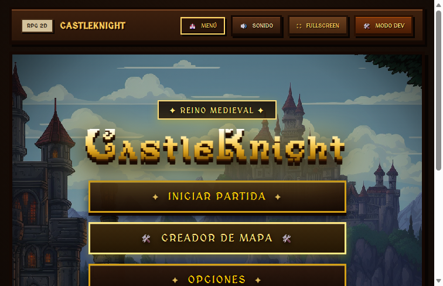
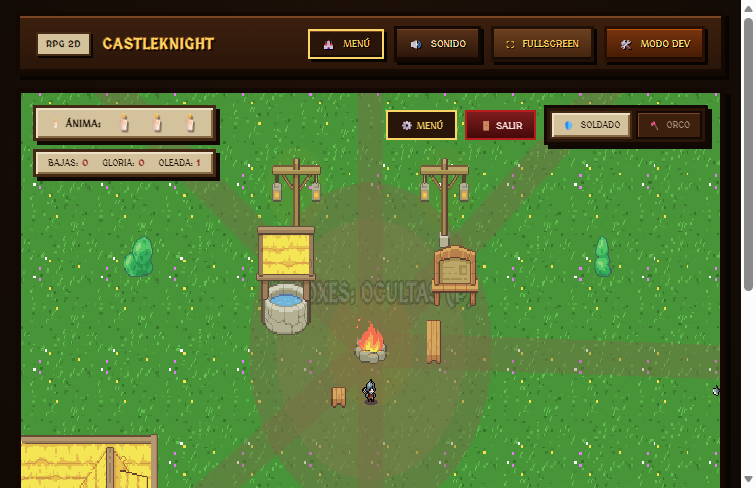
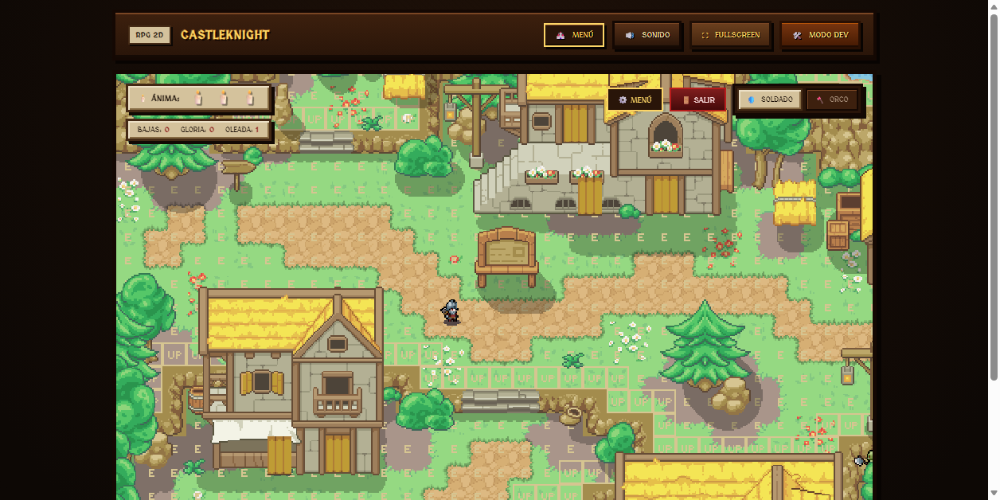
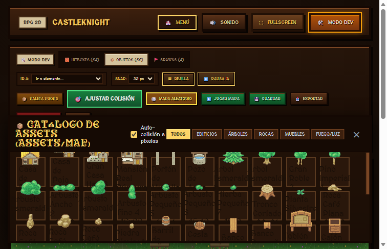

# ⚔️ CastleKnight - 2D Top-Down RPG

[](https://phaser.io/)
[](https://developer.mozilla.org/es/docs/Web/JavaScript)
[](https://developer.mozilla.org/es/docs/Web/HTML)
[](https://nodejs.org/)

Un videojuego RPG de acción en 2D con perspectiva cenital (Top-Down) desarrollado en **Phaser 3**, **HTML5 Canvas** y **JavaScript**. Incluye modos de juego seleccionables, un editor de mapas integrado, combate con animaciones y efectos de sonido en tiempo real.

---

## 📸 Capturas de Pantalla

| Menú Principal con Selector de Modos | Modo de Juego (Combate y HUD) |
| :---: | :---: |
|  |  |

| Renderizado de Capas Tiled | Editor de Mapas Integrado |
| :---: | :---: |
|  |  |

---

## 🗂️ Estructura del código

El código está separado por funcionalidad en `js/core`, `js/config`, `js/maps` y `js/scene`. La guía con el mapa de carpetas y las recetas para agregar, mover o quitar cosas está en [docs/ESTRUCTURA.md](docs/ESTRUCTURA.md). Después de tocar la estructura: `npm run check`.

---

## 🎮 Modos de Juego

1. **Modo Práctica (Tutorial):**
   - Campo de entrenamiento: plaza de tierra, carpas, arquería, herrería, fogón y una casa con humo en la chimenea y puerta que se abre al acercarse.
   - Oleadas de orcos para practicar.
   - Ideal para probar controles, combos de ataque y esquivas.
2. **Modo Campaña ("The Kingdom's Outpost"):**
   - Mapa extendido de 80×60 tiles (1280×960 px) creado con 18 tilesets de alta calidad.
   - Incluye ríos, puentes, caminos empedrados, campamento con fogata, bosques y acantilados rocosos.
3. **Editor de Mapas en Tiempo Real:**
   - Herramienta integrada dentro de la interfaz para dibujar, estampar elementos, generar biomas aleatorios y exportar configuraciones personalizadas.

---

## 🕹️ Controles del Juego

| Acción | Tecla / Control |
| :--- | :--- |
| **Moverse** | `W`, `A`, `S`, `D` o Flechas de dirección |
| **Ataque Básico / Combo** | Clic Izquierdo o Barra Espaciadora |
| **Dash / Esquiva** | Shift Izquierdo |
| **Habilidades Especiales** | Teclas `1`, `2`, `3`, `4` |
| **Pausa / Menú** | `ESC` |

---

## 📁 Estructura del Proyecto

```text
CastleKnights/
├── index.html               # El juego: abre con doble clic (scripts clásicos, en orden)
├── pruebas.html             # Abre el juego en modo pruebas (no guarda partida)
├── styles.css, ui-theme.css # Estilos de menús, HUD y modales
├── assets/                  # Imágenes, sonidos y música que usa el juego
│   ├── Music/  audio/       # Música por zona y efectos
│   ├── UI/  font/  intro/   # Interfaz, fuentes y video de inicio
│   ├── characters/  npc/    # Héroes, enemigos, guardias y aldeanos
│   ├── map/  map2/          # Mapa de práctica y aldea (Tiled)
│   ├── castle/  ruins/  interiors/   # Castillo, ruinas y casas
│   ├── taller/              # Piezas del taller (casa, props)
│   └── aseprites/           # Archivos fuente de Aseprite propios
├── js/
│   ├── game.js              # Arranque (siempre el último script)
│   ├── *_assets.js, *_data.js   # Arte embebido en base64 (generado, no se edita a mano)
│   ├── config/  maps/  scene/   # Ver docs/ESTRUCTURA.md
│   └── core/                # Sistemas sueltos, cada uno en su archivo (se quitan borrando su línea en index.html):
│       ├── ck_luz.js  ck_clima.js  ck_nieve.js      # luz dinámica, lluvia / tormenta / nieve, nieve acumulada y ríos helados
│       ├── ck_fauna.js  ck_detalles.js  ck_heroe_fx.js  ck_vida.js   # animales, detalles del entorno, efectos del héroe
│       ├── ck_minimapa.js  ck_historia.js  ck_partidas.js  ck_dialogo.js   # minimapa, historia, partidas guardadas, diálogos
│       └── ck_aldea.js  ck_camino*.js  ck_mapas_nuevos.js   # mapas hechos en el editor (AcePixelStudio)
├── tools/                   # Generadores de mapas y empaquetado de arte (Python)
├── scripts/                 # Verificación (npm run check) y pruebas viejas
├── docs/                    # ESTRUCTURA.md y capturas
├── TRASPASO.md              # Estado actual del proyecto y cómo está armado (notas de desarrollo)
├── TRASPASO_historial.md    # Historial de cambios
└── CAMBIOS_PENDIENTES.md    # Lo que falta hacer
```

Lo que **no** se sube está en `.gitignore`: dependencias, temporales, y el material de origen que el juego no usa
(`assets/raw/`, `assets/characters/nuevos/`), que queda solo en la PC.

El editor de mapas, animaciones y arte está en otro repositorio: **AcePixelStudio**.

---

## 🚀 Cómo jugar

**Doble clic en `index.html`** (Chrome o Edge). No hace falta instalar nada: todo el arte va embebido.

Con servidor local (opcional):

```bash
npm install
npm start          # http://localhost:3000
```

---

## 🛠️ Scripts Disponibles

- `npm start`: Inicia el servidor local en el puerto 3000.
- `npm run generate:map`: Regenera el mapa de campaña `assets/map2/campaign_map.json`.
- `npm run patch:map`: Parchea y sincroniza definiciones de tilesets en `assets/map2/mapa1.json`.
- `npm run build:extra`: Vuelve a generar `js/chars_extra_assets.js` (el resto del pack de personajes: ataques, bloqueos, invocaciones, el orco jinete y cuatro aldeanos) desde el pack original, que queda solo en la PC (`assets/characters/nuevos/`, ignorado por git).

---

## 📄 Licencia

Este proyecto está bajo la Licencia ISC. Consulta los archivos fuente para más detalles sobre assets y atribuciones.
